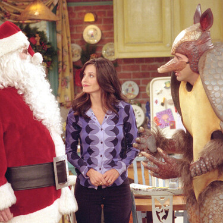
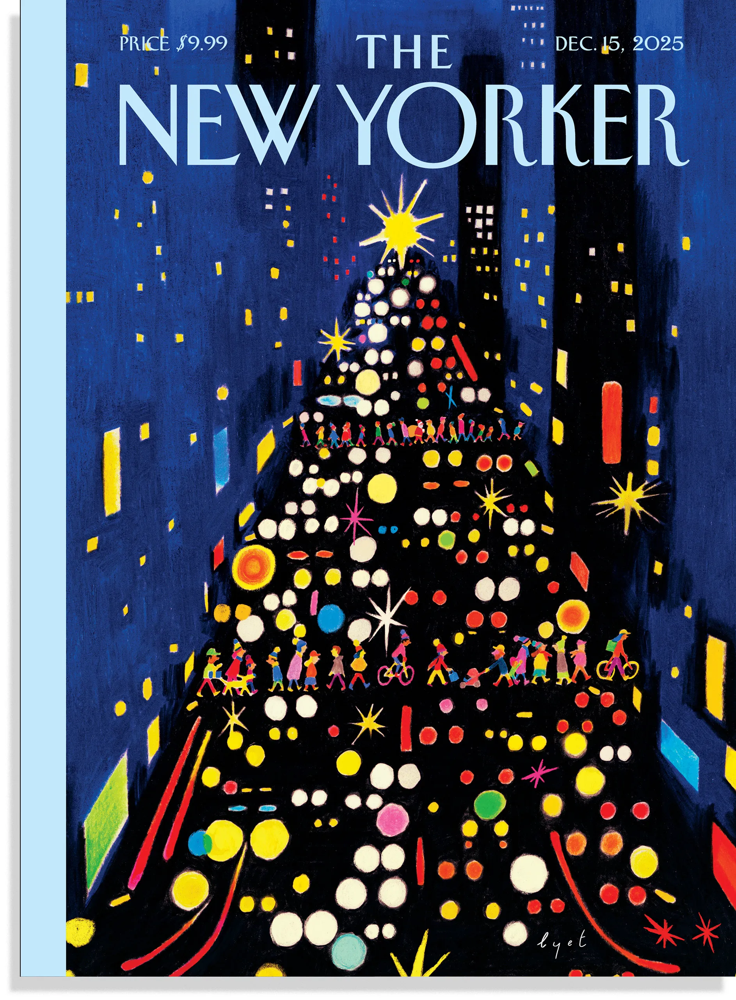
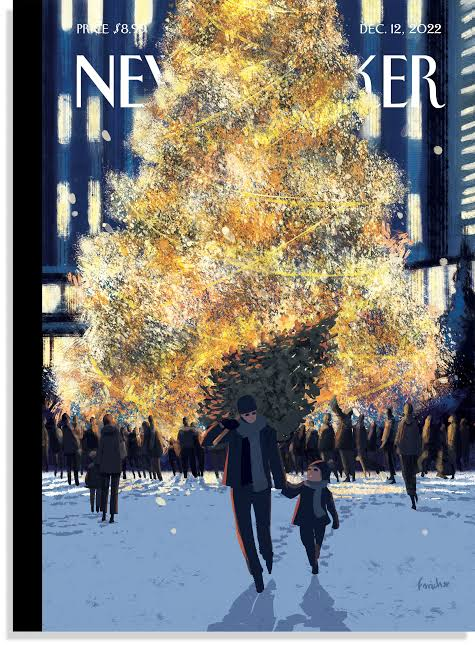
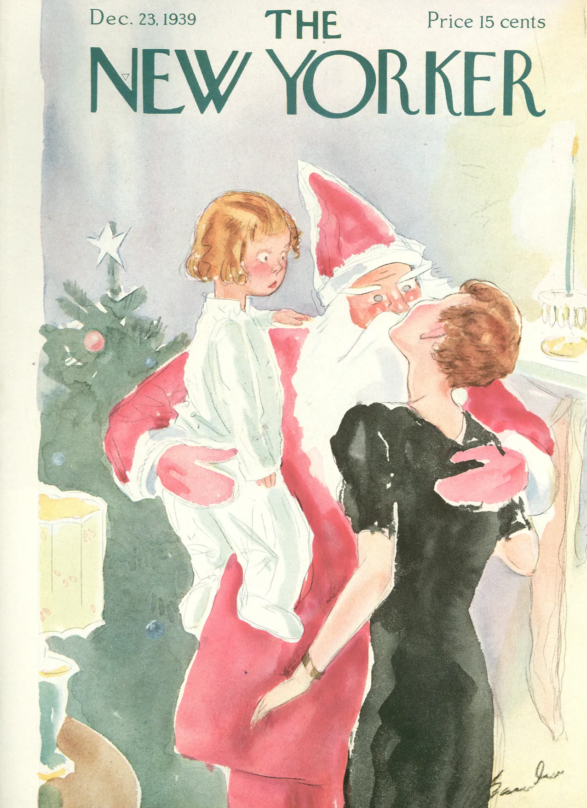
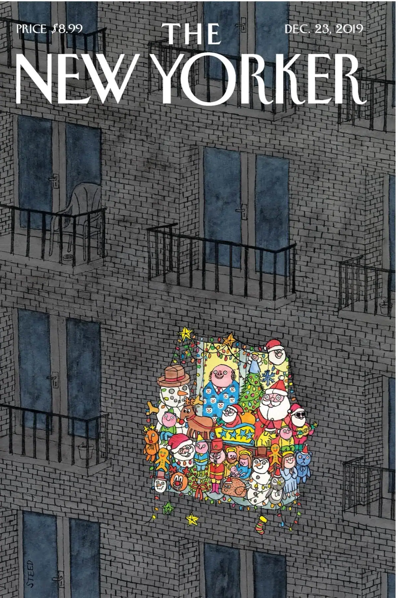
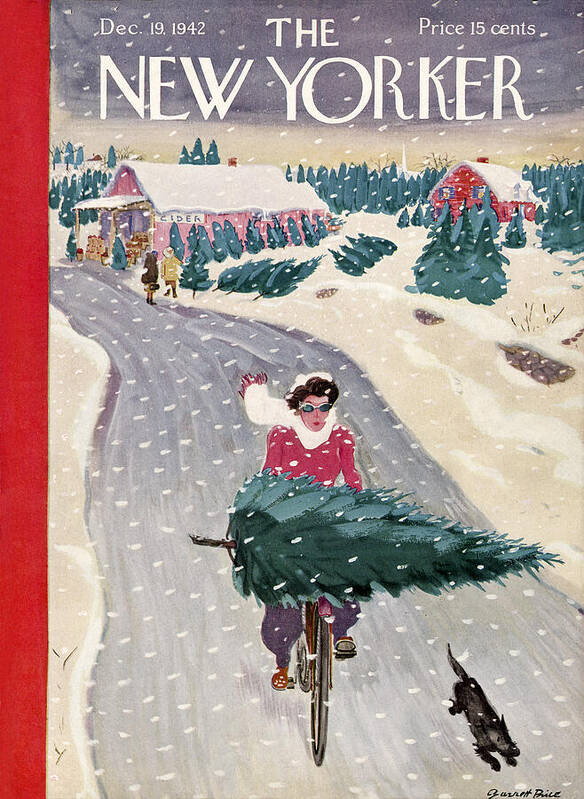

# ProyectoFinal
Se presentara una revista con una historia navideña 
Me gustaria hacer un web fanzine direcionado a una revista de navidad, aprovechando la epoca del año. En la revusta seria interesante que hayan como "noticias" pero que estas tengan referecias a series, peliculas o canciones de este tema. 
Como primer avance, agregue todos los archivos de html, css, java y assets 
Como primera parte Subo los assets, los cuales incluen todas las imagenes, audios y videos que utilizare para en fanzine. 

# Inspoimagenes

# Inspoderevistas 

Carpeta de assets: 
portada: con 10 imágenes nombradas; portada1, portada2… portada10
ciudades: con 10 imágenes nombradas; ciudad1, ciudad2… ciudad10
disney: con 10 imágenes nombradas; disney1, disney2… disney10
tele: con 10 imagenes nombradas; tele1, tele2… tele10
yo: con 4 imagenes; yo1, yo2, yo3, yo4
cierre (fin de la revista): con 10 imagenes; cierre1, cierre2… cierre10 
Archivos: 
index.html
estilo.css
java.js 

En este segundo avance para la preentrega organice toda la libreria para que la pagina tenga ese efecto de libro, ultice las guias de github https://github.com/frostyfoxie/flip-book/blob/main/index.html
De ahí lo organice con su respectivo css que nos ayuda a que se vea bien en apariencia (tiene como se ve el libro en general y las especificaciones por pagina) y java script el cual nos ayuda con el movimiento de las paginas 
Me toco hacer bastantes cambios pues no me estaba leyendo el css, por lo que me di cuenta que lo estaba llamando mal desde html y le hice los cambios pertinentes, lo mismo con java script, se estaba llamando mal desde el html y lo arregle. 
Despues de lograr tener la libreria que me diera el formato que quiero, procedo a ir corrigiendo y agregando la informacion personal para mi revista navideña. Lo primero que hago es quitar las imagenes de la libreria y agregar las mias que guarde como assets dentro de mis archisvos, cada pagina del libro sera una sub carpeta de mis assets. 
Por otro lado en la parte del .css la libreia tenia colores muy azule sy formales por loq ue le cambie un poco el formato para que se viera mas navideño. 
Acomode el libro en css pues senti que en la libreria original estaba muy lejos de la vista del lector 