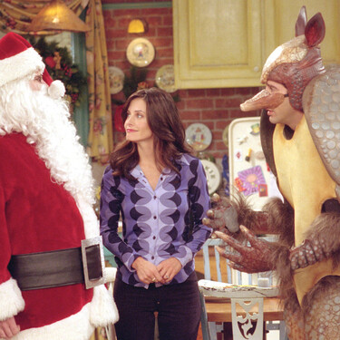
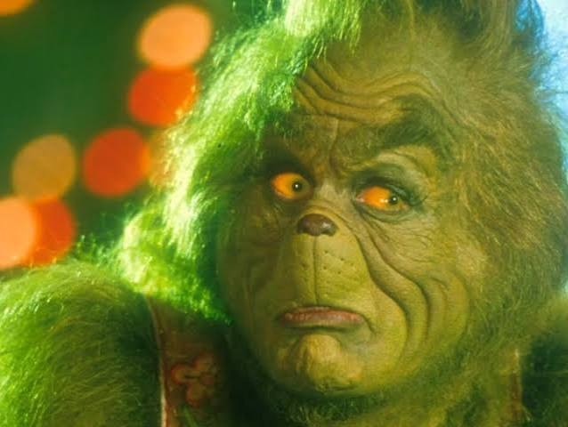
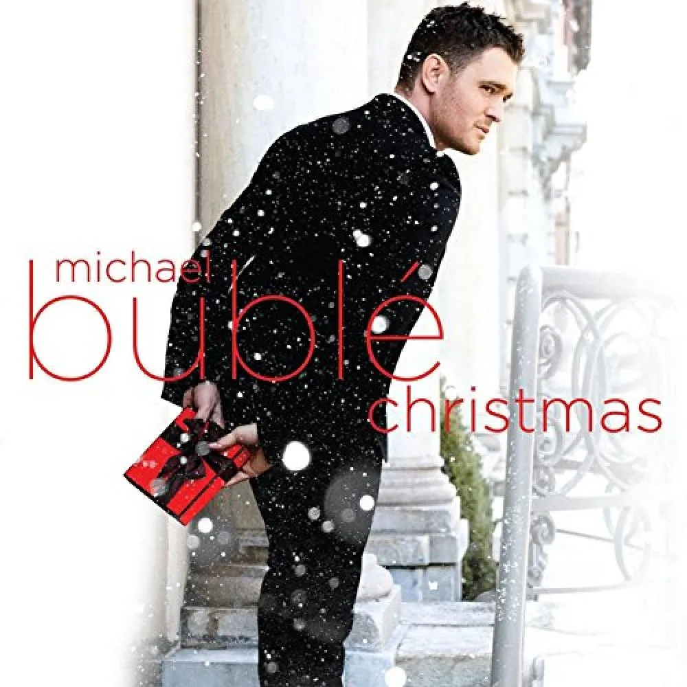
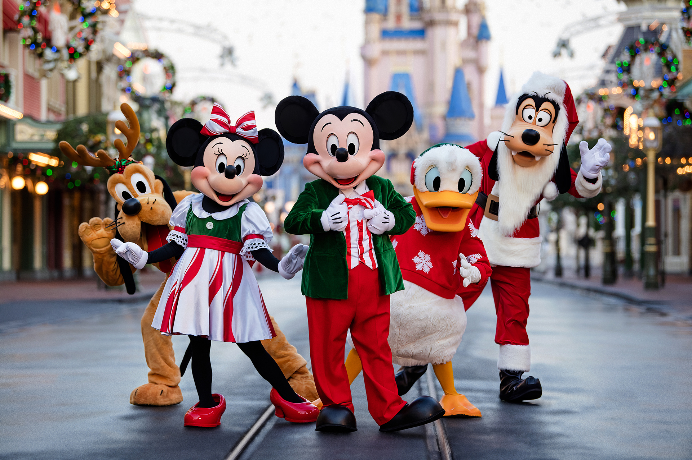
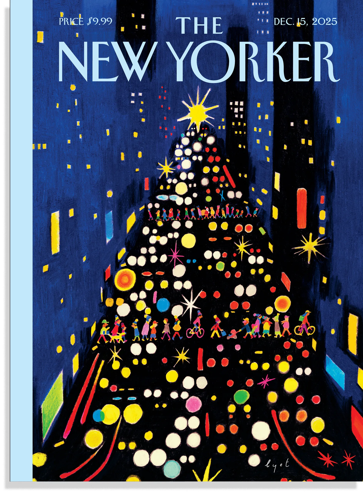
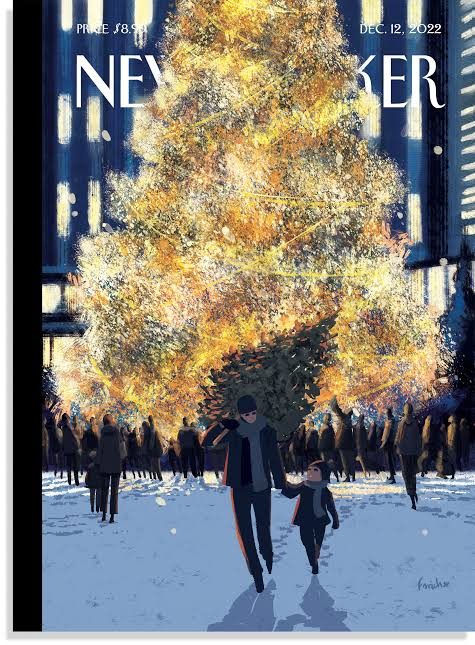
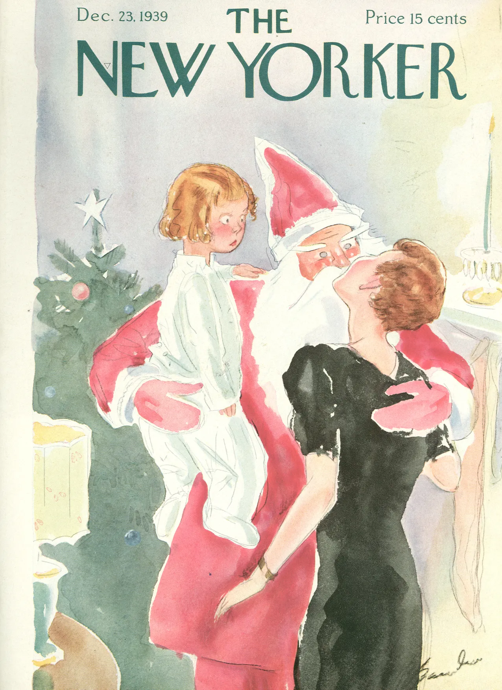
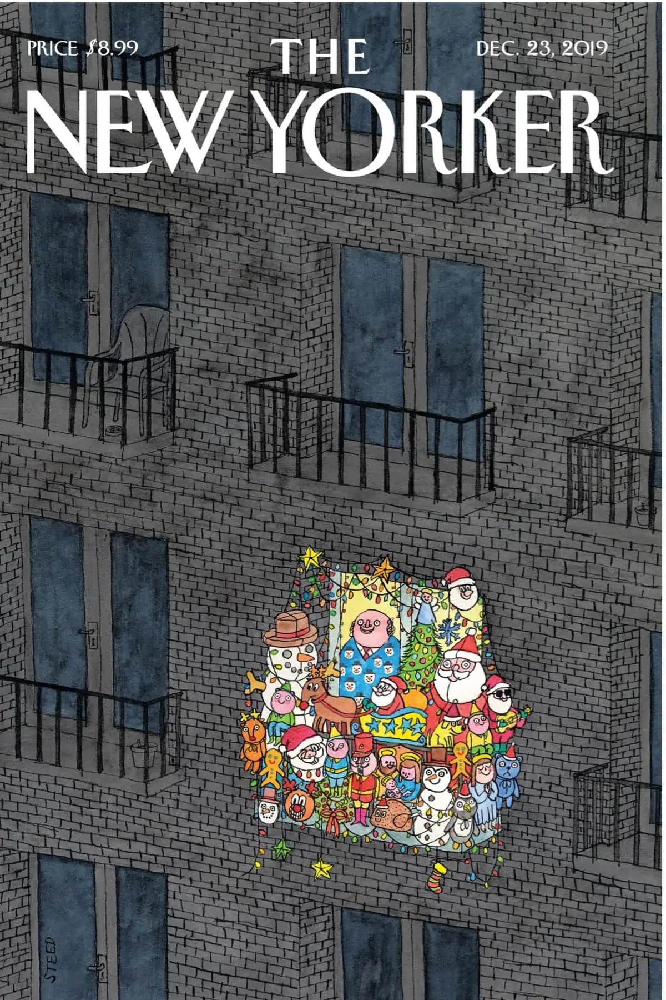
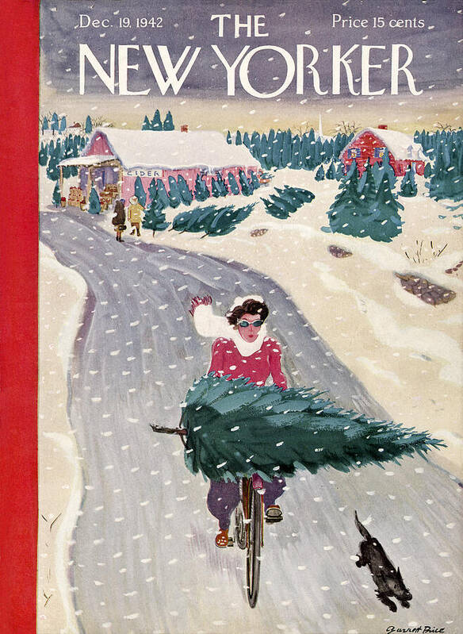

# ProyectoFinal
Se presentara una revista con una historia navideña 
Me gustaria hacer un web fanzine direcionado a una revista de navidad, aprovechando la epoca del año. En la revusta seria interesante que hayan como "noticias" pero que estas tengan referecias a series, peliculas o canciones de este tema. 
Como primer avance, agregue todos los archivos de html, css, java y assets 
Como primera parte Subo los assets, los cuales incluen todas las imagenes, audios y videos que utilizare para en fanzine. 
#Inspoimagenes

#Inspoderevistas 

